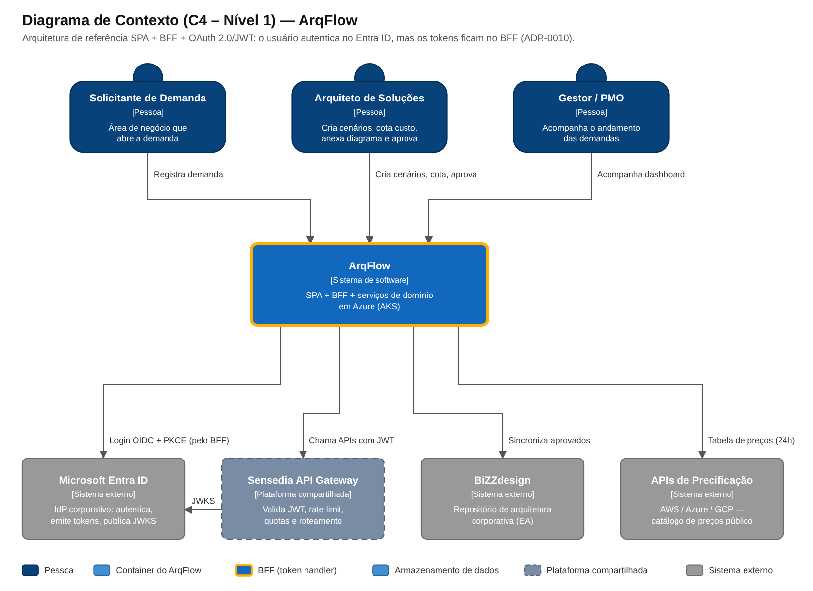
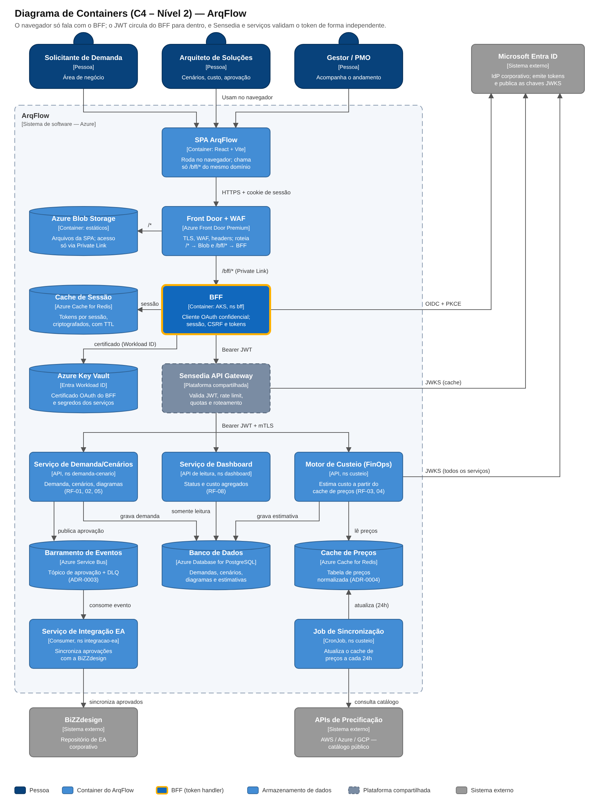
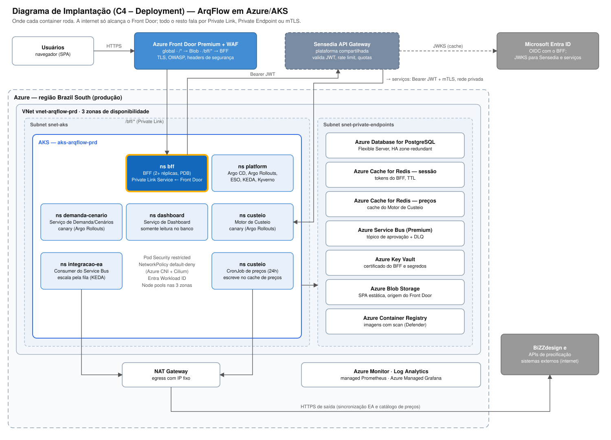
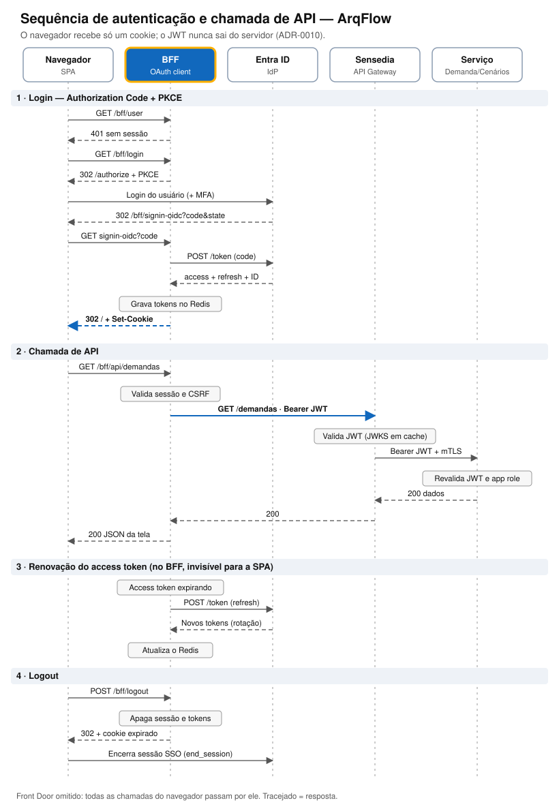

# Diagramas

Diagramas em modelo **C4** (Contexto → Containers → Implantação), mais um diagrama de sequência do fluxo de autenticação. Seguem a arquitetura de referência **SPA + BFF + OAuth 2.0/JWT (Azure + Sensedia)** adotada no [ADR-0010](../03-decisoes-arquiteturais/0010-bff-como-token-handler-com-entra-id-e-sensedia.md) e no [ADR-0011](../03-decisoes-arquiteturais/0011-migrar-plataforma-de-aws-eks-para-azure-aks.md).

1. [`contexto.drawio`](contexto.drawio) / `contexto.png` — o ArqFlow, seus usuários e os sistemas externos: Microsoft Entra ID, Sensedia, BiZZdesign e APIs de precificação de nuvem
2. [`containers.drawio`](containers.drawio) / `containers.png` — SPA, Front Door, BFF, Sensedia, serviços de domínio e armazenamentos, e como se comunicam
3. [`implantacao-c4.svg`](implantacao-c4.svg) — onde cada container roda em Azure/AKS
4. [`sequencia-autenticacao.svg`](sequencia-autenticacao.svg) — login, chamada de API, renovação de token e logout

Os arquivos `.drawio` são editáveis no [draw.io](https://app.diagrams.net/). Os PNG e os SVG são gerados a partir do mesmo layout.

## Diagrama de Contexto

**Leitura:** o usuário faz login no Entra ID pelo navegador, mas os tokens ficam com o BFF do ArqFlow, nunca no navegador ([ADR-0010](../03-decisoes-arquiteturais/0010-bff-como-token-handler-com-entra-id-e-sensedia.md)). A Sensedia valida o JWT com as chaves públicas (JWKS) do Entra ID, sem consultá-lo a cada requisição. A sincronização com a BiZZdesign e com as APIs de precificação continua assíncrona/periódica ([ADR-0003](../03-decisoes-arquiteturais/0003-sincronizacao-assincrona-com-bizzdesign.md) e [ADR-0004](../03-decisoes-arquiteturais/0004-motor-de-custeio-com-cache-de-precos.md)).

## Diagrama de Containers

**Leitura:**
- A SPA só chama rotas `/bff/*` no mesmo domínio. O Front Door entrega os arquivos estáticos a partir do Blob Storage e encaminha `/bff/*` ao BFF por Private Link.
- O **BFF** é o único cliente OAuth do Entra ID (Authorization Code + PKCE, autenticado por certificado via Workload ID). Guarda os tokens no **Cache de Sessão** (Redis) e entrega ao navegador só um cookie `HttpOnly`.
- O BFF chama a **Sensedia** com o JWT. A Sensedia valida o token, aplica rate limit e quotas e encaminha aos serviços por mTLS. Cada serviço revalida o JWT e aplica a autorização por app role (Solicitante, Arquiteto, Gestor/PMO).
- A aprovação de um cenário publica um evento no **Azure Service Bus**, consumido pelo **Serviço de Integração EA** — a aprovação nunca espera a BiZZdesign responder (ADR-0003).
- O **Motor de Custeio** lê do **Cache de Preços**, atualizado por um CronJob a cada 24h (ADR-0004) — por isso a cotação é local e rápida (RNF < 1s). O Cache de Preços é uma instância separada do Cache de Sessão.
- O Gateway de Identidade (broker OIDC/SAML) do desenho anterior foi removido: com uma única empresa e um único IdP, ele deixou de ter função ([ADR-0002](../03-decisoes-arquiteturais/0002-federacao-de-identidade-via-gateway-oidc.md), substituído).

## Diagrama de Implantação (C4 - Deployment)

**Leitura:** mostra *onde* cada container roda — namespace do AKS ou serviço gerenciado do Azure. A internet só alcança o Front Door. O BFF recebe tráfego do Front Door por Private Link Service; os serviços de dados ficam atrás de Private Endpoints; a saída para a BiZZdesign e para as APIs de precificação passa por um NAT Gateway com IP fixo. Detalhes em [`06-implantacao-e-operacao/arquitetura-azure.md`](../06-implantacao-e-operacao/arquitetura-azure.md).

## Diagrama de sequência

**Leitura:** os dois passos em destaque são a garantia do padrão — no login o navegador recebe só o cookie de sessão, e o primeiro salto com JWT é do BFF para a Sensedia. A renovação do access token acontece no BFF, sem a SPA perceber.

---

**Nota técnica:** os diagramas são gerados por script a partir de um único layout com coordenadas explícitas (o `.drawio` para edição e o PNG/SVG para leitura no GitHub). A primeira versão do diagrama de implantação foi feita em Mermaid; com muitos elementos aninhados, o layout automático do GitHub sobrepunha caixas e texto, e por isso a troca por coordenadas fixas.
