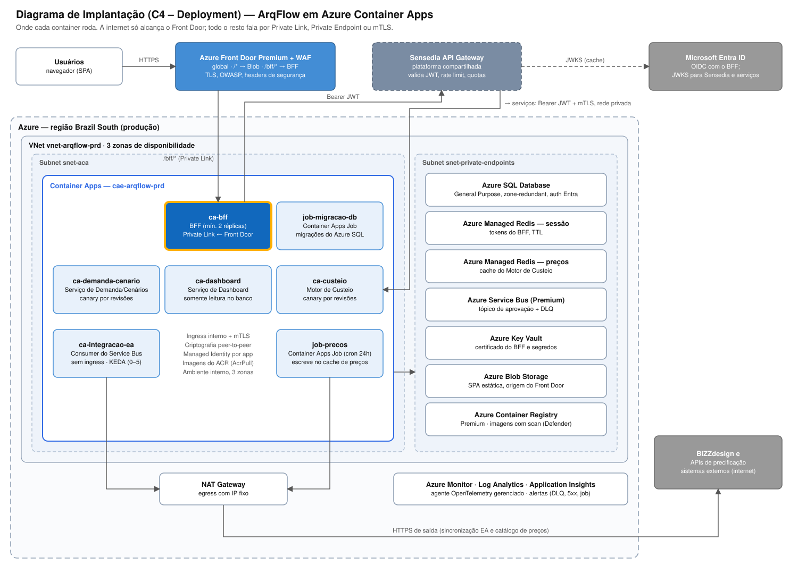

# Arquitetura Azure de Referência

Esta arquitetura implanta os containers de [`04-diagramas/containers.png`](../04-diagramas/containers.png) sobre Azure, na stack Microsoft: **Azure Container Apps** como gerenciador de containers ([ADR-0012](../03-decisoes-arquiteturais/0012-azure-container-apps-como-plataforma-de-compute.md)), **Azure SQL Database** como banco relacional ([ADR-0013](../03-decisoes-arquiteturais/0013-azure-sql-database-como-banco-relacional.md)), **Azure Front Door Premium + WAF** na borda e **Azure Container Registry** para as imagens, seguindo o padrão **SPA + BFF + OAuth 2.0/JWT** da arquitetura de referência corporativa ([ADR-0010](../03-decisoes-arquiteturais/0010-bff-como-token-handler-com-entra-id-e-sensedia.md)). Três preocupações guiam o desenho: nenhum token no navegador, nenhuma origem exposta à internet além do Front Door, e resiliência a sistemas de terceiros indisponíveis (BiZZdesign, APIs de precificação).

## Diagrama

*(Nível C4 de Implantação: mostra onde cada container roda. Como eles se comunicam está no [Diagrama de Containers](../04-diagramas/containers.png); o fluxo de login está no [diagrama de sequência](../04-diagramas/sequencia-autenticacao.svg).)*

**Leitura do diagrama:** a SPA é servida pelo Azure Front Door Premium a partir do Blob Storage, sob WAF com regras gerenciadas (OWASP). As rotas `/bff/*` vão do Front Door ao BFF por Private Link para o ambiente interno do Container Apps. O BFF chama a Sensedia com o JWT; a Sensedia encaminha aos serviços de domínio pela rede privada, com mTLS. Azure SQL, Redis, Service Bus, Key Vault e Container Registry só são alcançáveis por Private Endpoint. A saída para a BiZZdesign e para as APIs de precificação passa por um NAT Gateway com IP fixo (útil para allowlist do lado dos terceiros).

## Borda e identidade

| Componente | Configuração |
| --- | --- |
| Azure Front Door Premium + WAF | Domínio único (`arqflow.<empresa>`). `/*` → Blob, `/bff/*` → BFF (origem Private Link no ambiente do Container Apps). WAF em modo Prevention, regras gerenciadas (Default Rule Set) + Bot Manager + rate limit por IP. Headers: CSP restritiva, HSTS, `X-Content-Type-Options`, `Referrer-Policy`, `frame-ancestors 'none'`. O tier Premium é obrigatório: Private Link não existe no Standard. |
| Microsoft Entra ID | App registration do BFF (confidential client, certificado/federated credential, redirect URI exata) e app registration das APIs (scopes `demandas.read`, `demandas.write`, `custeio.read` e app roles Solicitante, Arquiteto, Gestor/PMO). Um registro por ambiente. |
| BFF | Authorization Code + PKCE; tokens no cache de sessão; cookie `__Host-` `HttpOnly; Secure; SameSite`; CSRF por header customizado; renovação com rotação do refresh token; logout local + `end_session_endpoint`. |
| Sensedia API Gateway | Plataforma compartilhada da empresa. Valida JWT (assinatura via JWKS em cache, `iss`, `aud`, `exp`, scopes), rate limit e quotas por API, roteamento para o ingress interno dos serviços com mTLS (certificado de cliente exigido no ingress do Container App). |

## Rede

VNet em Brazil South, com três zonas de disponibilidade:

| Subnet | Uso |
| --- | --- |
| `snet-aca` (/23, delegada a `Microsoft.App/environments`) | Infraestrutura do ambiente do Container Apps. NAT Gateway associado para egress com IP fixo. |
| `snet-private-endpoints` (/24) | Private Endpoints de Azure SQL, Redis, Service Bus, Key Vault, Blob e ACR. |

- O ambiente do Container Apps é **interno**, com **acesso público desabilitado**. Não existe IP público de entrada; o Front Door chega ao BFF pelo Private Endpoint que ele mesmo cria e que é aprovado no ambiente.
- Nenhum serviço de dados tem acesso público. A resolução de nomes usa zonas DNS privadas do Azure (`privatelink.*`).
- A Sensedia alcança o ambiente pela conectividade privada corporativa (VPN/ExpressRoute até o hub), não pela internet.
- Isolamento entre serviços (sem `NetworkPolicy`, ver [ADR-0012](../03-decisoes-arquiteturais/0012-azure-container-apps-como-plataforma-de-compute.md)): o worker de Integração EA e o job de preços **não têm ingress**; os demais têm ingress **interno**; a criptografia peer-to-peer do ambiente cifra o tráfego entre apps; NSG na subnet restringe origens e destinos; e cada serviço revalida o JWT.

## Compute — Azure Container Apps

Um ambiente por estágio (`cae-arqflow-dev`, `-hml`, `-prd`), do tipo **workload profiles**, usando o perfil **Consumption** (pagamento por segundo), com redundância de zona em produção.

| Container App / Job | Ingress | Réplicas (prd) | Escala |
| --- | --- | --- | --- |
| `ca-bff` | Interno, origem do Front Door | 2–6 | HTTP (requisições concorrentes) |
| `ca-demanda-cenario` | Interno, mTLS (Sensedia) | 2–6 | HTTP |
| `ca-custeio` | Interno, mTLS (Sensedia) | 2–4 | HTTP |
| `ca-dashboard` | Interno, mTLS (Sensedia) | 1–3 | HTTP |
| `ca-integracao-ea` | Nenhum | 0–5 | KEDA: mensagens na assinatura do Service Bus |
| `job-precos` | — | execução diária | Agendado (cron), 1 réplica |
| `job-migracao-db` | — | por deploy | Manual, disparado pela esteira ([ADR-0014](../03-decisoes-arquiteturais/0014-entrega-continua-por-revisoes-do-container-apps.md)) |

Detalhes de identidade, segredos, escala, revisões e probes em [`container-apps-boas-praticas.md`](container-apps-boas-praticas.md).

## Dados

- **Azure SQL Database** — General Purpose, 2 vCores provisionados, **redundância de zona**, autenticação **somente Microsoft Entra** (cada Container App entra com a própria Managed Identity), TDE, auditoria enviada ao Log Analytics e Microsoft Defender for SQL. Backup com redundância **ZRS**, não GRS: a região par de Brazil South fica nos EUA ([ADR-0013](../03-decisoes-arquiteturais/0013-azure-sql-database-como-banco-relacional.md)). O Dashboard usa um usuário somente leitura. *Confirmar a disponibilidade de redundância de zona do General Purpose em Brazil South na hora da implantação.*
- **Azure Managed Redis — sessão:** tokens do BFF por sessão, criptografados pela aplicação, com TTL igual à expiração absoluta da sessão.
- **Azure Managed Redis — preços:** cache do Motor de Custeio ([ADR-0004](../03-decisoes-arquiteturais/0004-motor-de-custeio-com-cache-de-precos.md)). Instância separada da de sessão, para que a política de despejo de uma não afete a outra.
- **Azure Service Bus (Premium):** tópico de aprovação de cenário com assinatura do Serviço de Integração EA ([ADR-0003](../03-decisoes-arquiteturais/0003-sincronizacao-assincrona-com-bizzdesign.md)). Mensagens que esgotam as tentativas vão para a dead-letter queue, que dispara alerta no Azure Monitor — é isso que garante que "falha de sincronização nunca é silenciosa". O tier Premium é o que permite Private Endpoint (ver custo em [`estimativa-finops.md`](estimativa-finops.md)).

> **Redis:** a Microsoft anunciou o **Azure Managed Redis** como sucessor do Azure Cache for Redis. Por isso o desenho já nasce em Azure Managed Redis; confirmar o SKU e o cronograma vigentes antes da implantação.

## Segurança e identidade de workload

- **Managed Identity por Container App** (atribuída por usuário, criada no Bicep): só o BFF lê o certificado OAuth no Key Vault; só o worker de Integração EA consome a assinatura do Service Bus e lê o token da BiZZdesign; só o job de preços escreve no cache de preços; o Dashboard só lê o Azure SQL. Nenhum app usa credencial estática.
- **Azure Key Vault:** certificado do cliente OAuth do BFF, chave de criptografia da sessão e token da BiZZdesign, referenciados pelo Container App como segredos do Key Vault (sincronizados pela plataforma, nunca commitados). O banco não tem senha para guardar: a autenticação é por Entra ID.
- **Azure Container Registry (Premium):** Private Endpoint, acesso público desabilitado, usuário admin desabilitado, tags imutáveis (SHA do commit). Os Container Apps puxam imagens com a própria Managed Identity (`AcrPull`). O **Microsoft Defender for Cloud** (plano Defender for Containers) faz a avaliação de vulnerabilidades das imagens no registry; imagem sem scan aprovado não é elegível para deploy (ver [`esteira-cicd.md`](esteira-cicd.md)).
- **Azure Policy:** nega Container App com ingress externo, recursos de dados com acesso público, imagens fora do ACR corporativo e recursos regionais fora de Brazil South (serviços globais, como o Front Door, ficam fora dessa regra).
- **Acesso humano:** Entra ID com RBAC por grupo e PIM (just-in-time) para produção; ninguém tem escrita permanente.

## Observabilidade

**Application Insights** (um por serviço, baseado em workspace) recebe traces, métricas e logs pelo **agente OpenTelemetry gerenciado** do Container Apps; **Log Analytics** centraliza os logs de console/sistema do ambiente, do Front Door/WAF e da auditoria do Azure SQL. O BFF gera o `traceparent` (W3C Trace Context) e ele é propagado pela Sensedia até os serviços, de modo que um login ou uma cotação pode ser seguido de ponta a ponta no mapa de aplicação. Alertas do Azure Monitor: DLQ do Service Bus com mensagens, taxa de 5xx por app, falha do job de preços, bloqueios do WAF acima do normal. Logs de segurança mínimos: login, logout, JWT rejeitado (401), falta de permissão (403), CSRF rejeitado e bloqueios do WAF. Tokens e cookies nunca são registrados.

## Estimativa de custo (FinOps)

Estimativa mensal desta arquitetura, com cenário otimizado e os trade-offs de cada alavanca, em [`estimativa-finops.md`](estimativa-finops.md).

## Infraestrutura como código

**Bicep**, com módulos por camada (rede, ambiente do Container Apps, dados, mensageria, identidade, borda) baseados nos Azure Verified Modules. Implantação por *deployment stacks* no escopo do resource group, com `what-if` em todo PR e como verificação diária de drift em produção ([ADR-0014](../03-decisoes-arquiteturais/0014-entrega-continua-por-revisoes-do-container-apps.md)). Ambientes (dev/hml/prd) têm parâmetros (`.bicepparam`) e subscriptions separados.

## O que foi deliberadamente deixado de fora (por ora)

- **AKS:** avaliado e substituído pelo Container Apps ([ADR-0012](../03-decisoes-arquiteturais/0012-azure-container-apps-como-plataforma-de-compute.md)). Gatilhos para voltar: isolamento L3/L4 entre serviços, controladores próprios, mais de ~15 serviços.
- **Workload profiles Dedicados:** o perfil Consumption atende à carga atual; um perfil Dedicado (ex.: D4) passa a valer a pena se o consumo constante superar o custo do nó.
- **Multi-região ativa-ativa:** o RNF de disponibilidade (99,5%) é atendido com três zonas em uma região. O Front Door já é global, o que facilita uma segunda região se o RNF mudar — mas uma segunda região fora do Brasil exigiria rever a residência dos dados.
