# Esteira de CI/CD

Descreve como uma mudança sai de um commit e chega a produção, em três esteiras independentes: **CI de aplicação**, **CD por revisões do Container Apps** ([ADR-0014](../03-decisoes-arquiteturais/0014-entrega-continua-por-revisoes-do-container-apps.md)) e **pipeline de infraestrutura** (Bicep). Ferramenta: GitHub Actions, no mesmo ecossistema onde o código está hospedado, autenticando no Azure por OIDC com o Microsoft Entra ID.

## Diagrama do fluxo

```mermaid
flowchart LR
    Dev["Dev abre PR"] --> Checks["Checks do PR:\nlint, testes, CodeQL,\nBicep what-if (se aplicável)"]
    Checks -->|aprovado + merge| CI

    subgraph CI["Pipeline de CI"]
        Build["Build da imagem"]
        Test["Testes automatizados"]
        Scan["Microsoft Security DevOps\n(Trivy, Checkov) + CodeQL"]
        Push["Push para o ACR\n(tag imutável = git sha)"]
        Build --> Test --> Scan --> Push
    end

    Push --> DeployDev["dev: nova revisão\n100% após smoke test"]
    DeployDev --> Hml["hml: environment do GitHub\nnova revisão + smoke test"]
    Hml -->|aprovação manual| Prd["prd: migração (job)\n+ nova revisão com 0%"]
    Prd --> Canary["Tráfego 10% → 50% → 100%\ncom checagem no App Insights"]
    Canary -->|métricas ok| Prod["100% em produção"]
    Canary -->|regressão| Rollback["Tráfego volta\npara a revisão anterior"]
```

## Estratégia de branching

Segue o [ADR-0009](../03-decisoes-arquiteturais/0009-estrategia-de-branches-e-ambientes.md): `feature/*` → `develop` (dev) → `homolog` (hml) → `main` (prd), sempre por Pull Request com CI verde. Cada branch de ambiente aciona o deploy no GitHub Environment correspondente.

## Pipeline de CI (por serviço)

1. **Lint e testes unitários** — falha aqui bloqueia o PR antes de qualquer build de imagem.
2. **Build da imagem** — multi-stage, imagem final mínima, usuário não-root.
3. **Scan de segurança** — CodeQL (SAST) e **Microsoft Security DevOps** (Trivy para imagem e dependências, Checkov e Template Analyzer para o Bicep). Vulnerabilidade crítica sem exceção documentada bloqueia o pipeline. O GitHub Advanced Security consolida os alertas.
4. **Push para o Azure Container Registry** com tag imutável (hash do commit, nunca `latest`) — rastreabilidade entre a imagem em produção e o commit que a gerou. Depois do push, o Defender for Containers avalia a imagem no registry.

## Pipeline de CD (revisões do Container Apps)

- **Login no Azure** com `azure/login` por OIDC: sem client secret. A federated credential do Entra ID aceita só `repo:<org>/arqflow-app:environment:<ambiente>`, então cada ambiente tem a própria identidade e só um job daquele GitHub Environment recebe o token.
- **Permissões da identidade de deploy:** `Container Apps Contributor` no resource group do ambiente e `AcrPush` no registry. Nada no banco, no Key Vault ou na rede.
- **Migração de banco:** em hml e prd, a esteira dispara o `job-migracao-db` (Container Apps Job) com a nova imagem e aguarda sucesso antes de liberar tráfego. Migrações seguem expand/contract.
- **Deploy:** cria uma nova revisão com a imagem **por digest** e 0% de tráfego, com o rótulo `candidata`; smoke tests rodam no endereço do rótulo.
- **Dev:** após o smoke test, 100% imediatamente.
- **Hml:** como dev, a partir da branch `homolog`, com testes de aceitação.
- **Prd:** aprovação manual no GitHub Environment (tech lead/gestor), dentro da janela de deploy. Canary por pesos (10% → 50% → 100%) nos serviços críticos (BFF, Demanda/Cenário, Motor de Custeio), com consulta automática ao Application Insights (5xx e p95) entre os passos — sem depender de alguém olhando o dashboard no momento do deploy.

## Gates de qualidade e segurança

Além dos checks da esteira, o **Azure Policy** funciona como segunda linha de defesa, mesmo que algo escape do pipeline: nega Container App com ingress externo, imagem fora do ACR corporativo e recursos de dados com acesso público. O Defender for Cloud aponta desvios de postura (CSPM).

## Pipeline de infraestrutura (Bicep)

Separado do pipeline de aplicação: `bicep build` + lint e `az deployment ... what-if` rodam em todo PR que toca módulos de infraestrutura, com o resultado comentado no PR; Checkov/Template Analyzer validam políticas (ex.: nenhum banco ou storage com acesso público, nenhum NSG aberto para `0.0.0.0/0` em porta de banco). A implantação usa *deployment stacks* (com `denySettings` para impedir alteração manual dos recursos gerenciados) e, em produção, exige aprovação manual explícita — mudança de infraestrutura tem blast radius maior e menos garantia de rollback automático. Um workflow agendado roda `what-if` diário em produção e abre uma issue se encontrar drift.

## Rollback

- **Aplicação:** mover 100% do tráfego para a revisão anterior (segundos, sem rebuild). A revisão com problema é desativada e fica disponível para investigação.
- **Rollout em andamento:** abortado automaticamente pela esteira com base nas métricas do canary.
- **Banco:** expand/contract garante que a revisão anterior continua funcionando com o schema novo; não existe "rollback de migração" em produção, e sim uma nova migração corretiva.
- **Infraestrutura:** reverter o commit do Bicep e reaplicar pelo pipeline — nunca aplicar fora da esteira.

## Segurança de credenciais na esteira

Nenhum segredo de longa duração é armazenado no GitHub. O token do Entra ID é emitido por execução, expira em minutos e só existe dentro de um job que passou pela aprovação do GitHub Environment. É a evolução do raciocínio do [ADR-0007](../03-decisoes-arquiteturais/0007-gitops-com-argocd-para-entrega-continua.md): a credencial com escrita em produção não é guardada em lugar nenhum.
